# AI 小程序开发工具（miniwechat） 

用自然语言描述需求，AI 在隔离工作目录里生成/修改一整套 **uni-app(Vue3) + TypeScript 小程序工程 + 自带 Node 后端**， 
自动跑构建校验（失败把错误回灌给模型重试），在浏览器里直接预览（前端+后端一起跑），最后一键导出可下载的工程 zip。 

## 页面效果 

### 1. 工具控制台（端口 5180 / 后端 9320） 

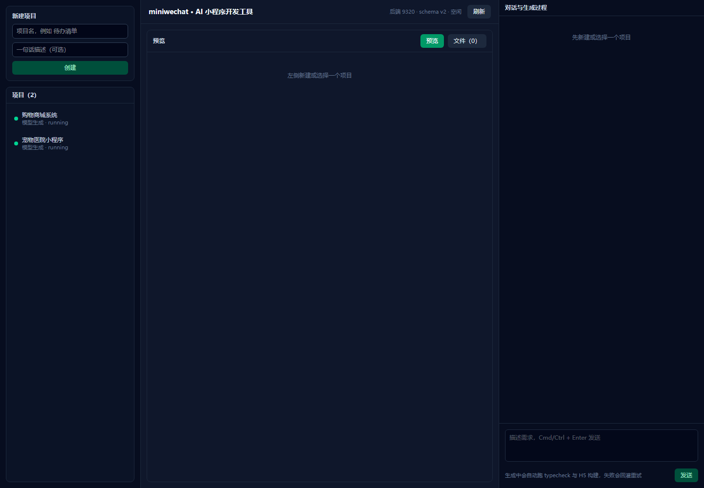

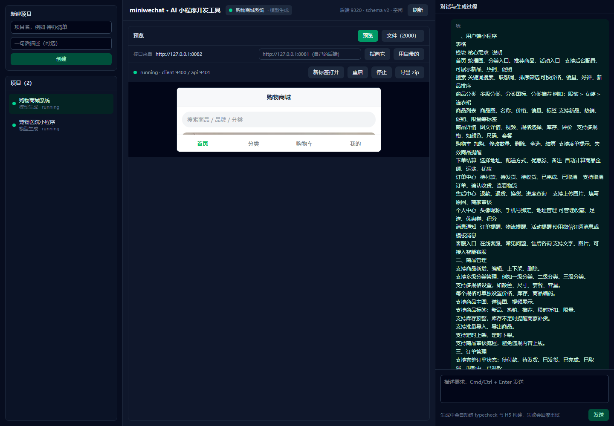

上图里可以看到：左侧项目列表、中间「接口来自」与预览 iframe（显示生成的小程序）、右侧需求对话与模型计划。 

### 2. 生成的小程序（浏览器预览，数据来自对接的后端） 

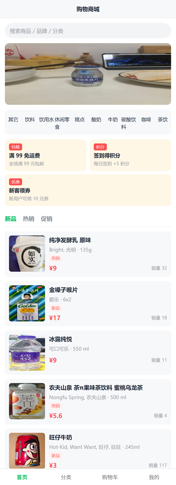

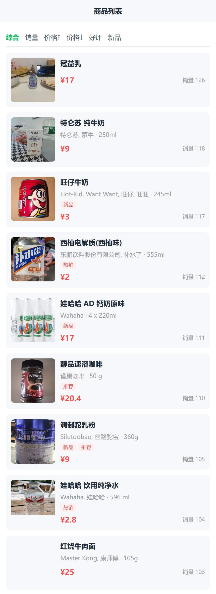

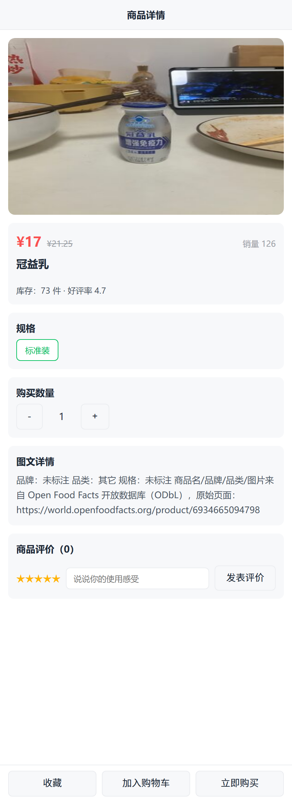

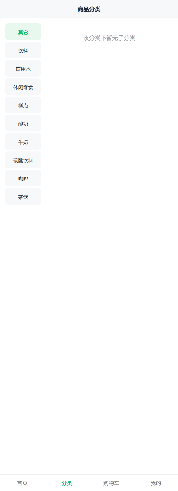

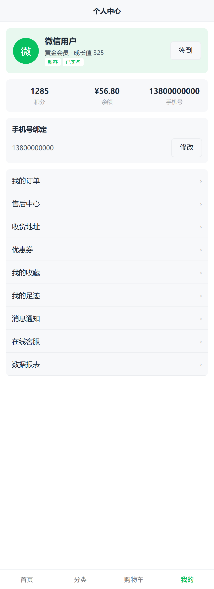

（商品名称/品牌/图片是真实公开数据，来自 Open Food Facts 开放数据库；价格是演示占位值。） 

### 3. 对接的后台系统（示例：Laravel 8 + MySQL 商城后台） 

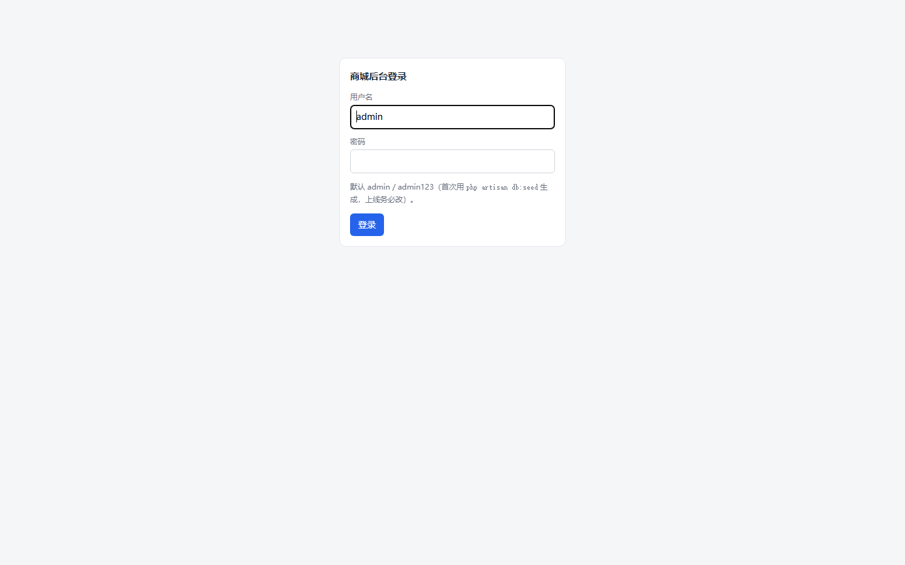

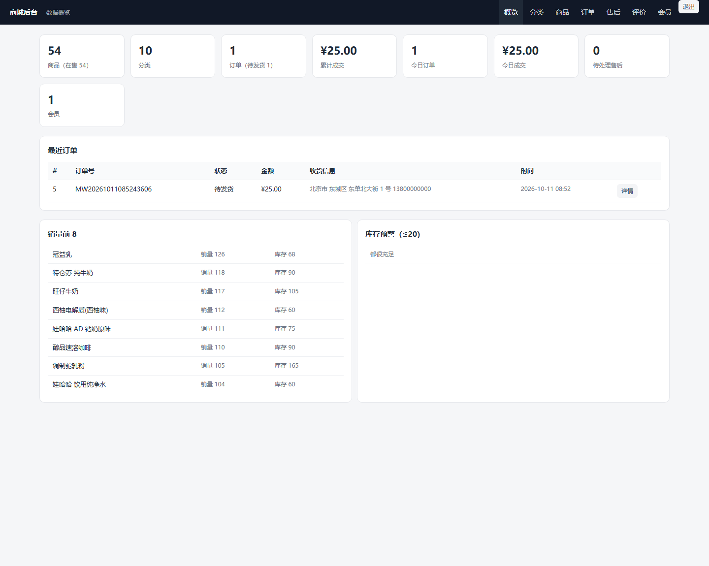

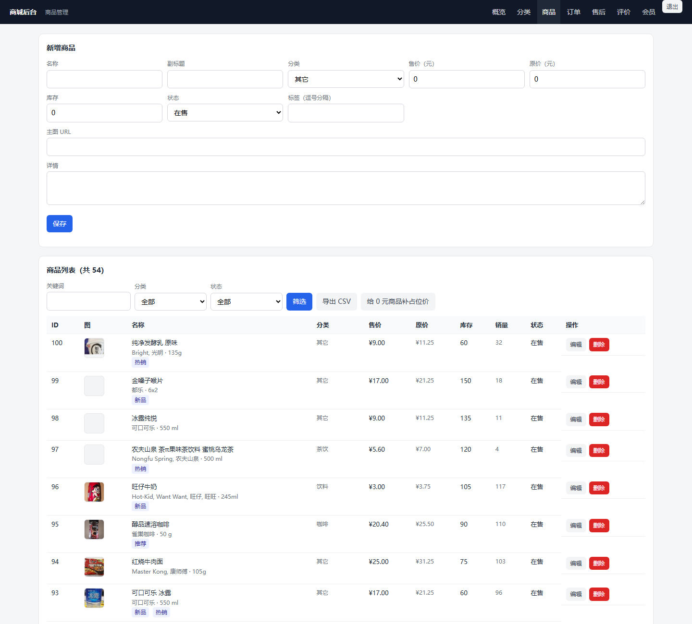

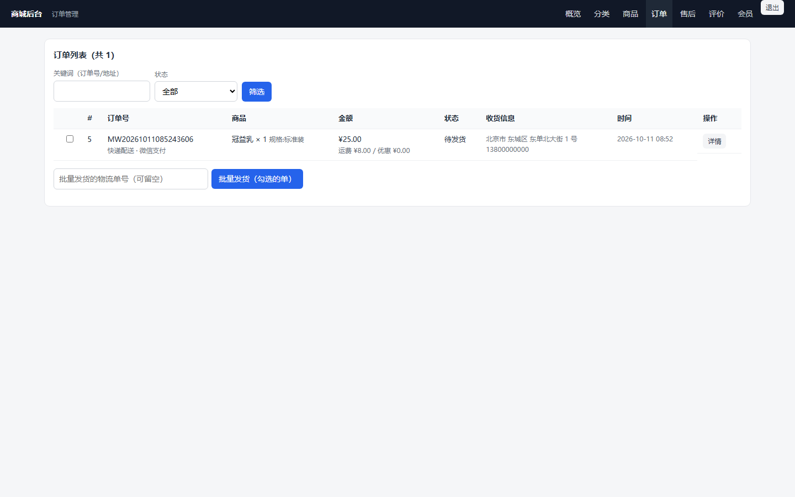

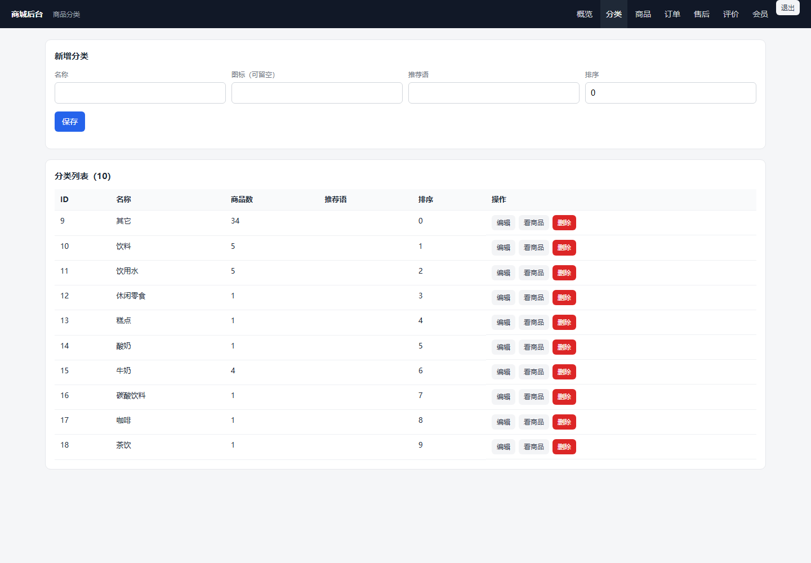

## 能做什么 

- **对话生成**：一轮 = `plan → 工具调用 → 文件落盘 → 构建校验 → 预览就绪`，全程 SSE 实时推给控制台；多轮对话就是读文件 + 打补丁的增量修改。 
- **沙箱边界**：所有工具都被限制在 `var/workspaces/<项目ID>/` 内，路径越界直接拒绝；`run_command` 只允许 `npm` / `node` / `npx`，带超时与输出截断。 
- **校验闭环**：生成后跑 `npm run typecheck`（client 与 server）与 H5 构建；失败把错误摘要回灌给模型自动重试（默认 2 轮），仍失败则以 `error` 结束并保留产物。 
- **离线可跑**：没有 `LLM_API_KEY` 时降级为离线脚手架模式，按模板生成示例工程，全链路（生成→校验→预览→导出）照样跑通。 
- **浏览器预览**：每个项目同时起 client（Vite H5）与 server 两个进程，通过 `/preview/<项目ID>/` 路径前缀反代对外暴露（同源，免跨域）。 
- **可挂自己的后端**：项目级 `apiOrigin` 一设，`/preview/<id>/api/*` 就直连你的后端，页面代码一行不用改（截图里的商城后台就是这么接的）。 
- **导出工程**：打成 zip 下载，内含 README 与在 HBuilderX / 微信开发者工具里的导入说明。 

## 快速开始 

```powershell
npm install
npm run dev          # 工具后端 9320 + 控制台 5180
```

- 控制台：http://127.0.0.1:5180
- 要真用模型：把 `.env.example` 复制成 `.env`，填 `LLM_API_KEY`（OpenAI 兼容协议，默认 DeepSeek 官方）；不填就是离线脚手架模式。 

## 目录结构 

```
server/   工具后端：Fastify + TypeScript（agent 生成链路 / runtime 沙箱与预览 / api 路由与 SSE / store SQLite / templates 工程模板） 
web/      控制台：Vite + React 18 + TypeScript + Tailwind
.claude/  skills/ 10 个开发技能（dev / generator / templates / preview / sandbox / api / llm / store / test / qa-workflow） 
var/      运行期产物（gitignore）：miniwechat.db、workspaces/<项目ID>/、logs/、exports/
```

端口固定：工具后端 `9320`、控制台 `5180`、每个项目的预览从 `9400` 起按槽位分配。 

## 验证方式 

```powershell
npm run typecheck      # server + web
npm test               # 41 个单测（沙箱越界、命令白名单、补丁、zip、SSE 契约、模板、外部后端…） 
npm run gen:types:check# 前端类型与 schemas.ts 是否同步 
npm run check:skills   # 技能 frontmatter 与行数校验 
npm run smoke:template # 渲染模板 → 装依赖 → typecheck → H5 构建 
npm run check:browser -- <项目ID> "期望出现的文字"   # 真浏览器渲染断言 
```

## 换成别的后端（三种路线） 

1. **对方已实现同样的接口**：控制台预览面板「接口来自」填它的地址 → 指向它 → 重启；客户端不用改。 
2. **接口长得不一样**：中间写一层薄适配（把对方字段映射成 `client/src/api/types.ts` 的契约），再把「接口来自」指向适配层。 
3. **整套换商城系统**：只要路径前缀 `/api`、返回 `{code:0,message:"ok",data:...}`、字段对齐 `types.ts`，前端同样不用改。 

接口契约只有两个约定：统一信封 `{code, message, data}`（`code=0` 成功），字段名与各项目里的 `client/src/api/types.ts` 一致。 
后端用什么语言都行 —— 仓库里两套后端（原生 PHP、Laravel 8）验证过这一点。 

